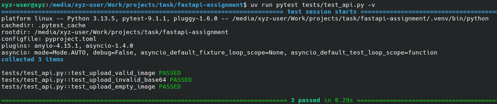
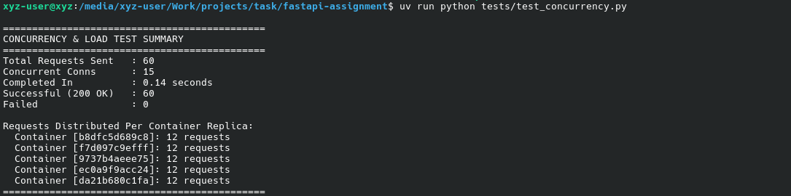

# FastAPI Image Ingestion Service

High-throughput FastAPI service built with `uv` designed to ingest base64-encoded image payloads, featuring process-level worker concurrency and horizontal container replication behind an Nginx reverse proxy.

---

## Architecture Overview

1. **Endpoint & Validation (`app/main.py`):**
   - Implements `POST /upload` accepting `{"image": "<base64_string>"}`.
   - Pydantic validator validates incoming base64 data, strips any data URI schemes if present, and returns `{"message": "accepted"}` on success or `422 Unprocessable Entity` on malformed payloads.
   - Injects an `X-Worker-Node` HTTP response header carrying the active container ID (`HOSTNAME`), making replica routing verifiable.

2. **Process-Level Concurrency (Worker Nodes):**
   - Each container runs Uvicorn with multiple worker processes (`--workers 2`), establishing parallel Python event loops across host CPU cores to bypass GIL contention during base64 decodes.

3. **Horizontal Replication & Load Distribution:**
   - Multiple identical server containers run as replicas within an isolated bridge network managed via Docker Compose.
   - Nginx functions as a reverse proxy gateway routing ingress traffic evenly across backend replicas via round-robin DNS resolution.

---
## Architecture
 ```test
                          Client
                           |
                           v
                    +-------------+
                    |    Nginx    |
                    | Reverse     |
                    |   Proxy     |
                    +------+------+
                           |
              +------------+------------+
              |            |            |
              v            v            v
         +---------+  +---------+  +---------+
         | FastAPI |  | FastAPI |  | FastAPI |
         |   #1    |  |   #2    |  |   #3    |
         +----+----+  +----+----+  +----+----+
              |            |            |
          2 workers    2 workers    2 workers
```


---

## Folder Structure

```text
.
├── app/
│   ├── __init__.py
│   └── main.py
├── docs/
│   └── images/
│       ├── Screenshot_20260927_180359-1.png
│       └── Screenshot_20260927_180443-1.png
├── tests/
│   ├── test_api.py           # Unit tests (Pytest)
│   └── test_concurrency.py   # Asynchronous multi-worker concurrency test
├── Dockerfile
├── docker-compose.yml
├── nginx.conf
├── pyproject.toml
└── README.md
```

### Unit Test Output



### Concurrency and Load Balancing



